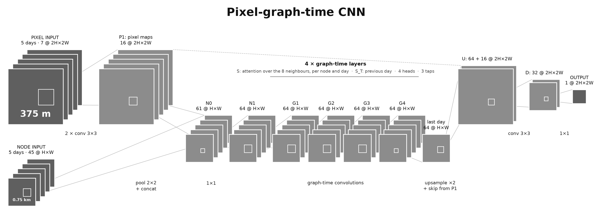

# GraphMLWildfire

Results are compared on the WildfireSpreadTS benchmark: see the [leaderboard](#benchmark).

## Setup

```bash
uv sync
```

## Download

Downloading only extracts the original GeoTIFF files. Download one fire:

```bash
uv run python -m graphml_wildfire.data.download_sample \
  --year 2018 \
  --fire fire_22343689
```

Omit `--fire` to download a complete year, or use `--full-dataset` for the
approximately 50 GB archive.

## Preprocess

Preprocess every downloaded fire into node grids:

```bash
uv run python -m graphml_wildfire.data.convert_hdf5 \
  data/raw/wildfirespreadts \
  data/processed/wildfirespreadts
```

The default preprocessing block size is `4`, so each node aggregates a `4 x 4`
patch of approximately 375 m pixels and has a side length of 1.5 km. It can be changed,
for example to `2 x 2` patches, with:

```bash
uv run python -m graphml_wildfire.data.convert_hdf5 \
  data/raw/wildfirespreadts \
  data/processed/wildfirespreadts \
  --block-size 2
```

The node side length is `block size x 375 m`.

For the [benchmark](#benchmark), add `--benchmark-crop` to centre-crop every image
like a WildfireSpreadTS test image, so the nodes tile exactly the scored pixels:

```bash
uv run python -m graphml_wildfire.data.convert_hdf5 \
  data/raw/wildfirespreadts \
  data/processed/wildfirespreadts_benchmark_b4 \
  --benchmark-crop
```

Each HDF5 file contains all days for one fire. It stores aggregated model
features, land-cover proportions, fire presence and fraction, raw physics
features, coverage, positions, dates, and geospatial metadata.

Here, `D` is the number of days for the fire, while `R` and `C` are the node
grid dimensions.

| Dataset | Shape | Type | Contents |
| --- | --- | --- | --- |
| `features` | `[D, 42, R, C]` | `float32` | Unnormalized model features: aggregated continuous values, sine/cosine direction channels, and 17 land-cover proportions plus unknown. |
| `physics` | `[D, 7, R, C]` | `float32` | Wind speed and direction, forecast wind speed and direction, elevation, slope, and aspect in their original units. |
| `fire_presence` | `[D, R, C]` | `uint8` | Binary indicator that at least one pixel in the node contains an active-fire detection. |
| `fire_fraction` | `[D, R, C]` | `float32` | Proportion of the node's real pixels containing an active-fire detection. |
| `fire_pixels` | `[D, R, C]` | `uint16` | Number of the node's pixels containing an active-fire detection. |
| `fire_time` | `[D, R, C]` | `float32` | Mean detection time (hhmm) of the node's burning pixels, NaN without fire. |
| `viirs_missing`, `ndvi_missing` | `[D, R, C]` | `float32` | Fraction of the node's pixels where VIIRS M11 or NDVI is missing. |
| `centre_pixels`, `centre_fire` | `[R, C]`, `[D, R, C]` | `uint16` | Number of the node's pixels, and of its burning pixels, inside the central 128 x 128 window of the original image. |
| `coverage` | `[R, C]` | `float32` | Fraction of a complete block covered by real raster pixels. Partial border nodes have values below one. |
| `positions` | `[2, R, C]` | `float64` | `x` and `y` coordinates of each node center. |

A pixel counts as an active-fire detection if its detection time is at least 01:00,
as in the official WildfireSpreadTS HDF5 files (`burning_pixels`).

File attributes store the year, fire ID, dates, CRS, transforms, block size,
original raster shape, crop, and channel names.

## Select Fires

Create one reproducible manifest that is reused across every year-wise fold:

```bash
uv run python -m graphml_wildfire.data.create_manifest \
  data/processed/wildfirespreadts \
  data/manifests/selected_fires.csv \
  --fraction 0.2 \
  --seed 42
```

This also allows us to reduce the size of the dataset by specifying the `fraction` argument.

## Normalize

For each cross-validation fold, compute statistics from only its two training
years once and keep them in memory. Reuse the same statistics object for the
training, validation, and test datasets. Statistics from validation or test
years must never be included.

```python
from graphml_wildfire.data import (
    NormalizedWildfireSpreadTSDataset,
    WildfireSpreadTSDataset,
    compute_statistics,
)

current_fold_training_years = [2018, 2019]

training_dataset = WildfireSpreadTSDataset(
    "data/processed/wildfirespreadts",
    years=current_fold_training_years,
    fire_manifest="data/manifests/selected_fires.csv",
)
training_statistics = compute_statistics(training_dataset)
normalized_training_dataset = NormalizedWildfireSpreadTSDataset(
    training_dataset,
    training_statistics,
)

sample = normalized_training_dataset[0]
print(sample["features"].shape)
print(sample["target"].shape)
```

`create_year_folds()` returns the 12 two-train, one-validation, one-test folds
over 2018-2021, in the order of the official WildfireSpreadTS code, so fold `i`
uses the same years as fold `i` in the published papers. Graph edges and shift operators are intentionally constructed
after this data pipeline.

## Build Graphs

Convert a normalized node grid into arrays, then build
the grid shift operator:

```python
from graphml_wildfire.graph import (
    build_grid_shift,
    create_graph_sample,
)

graph_sample = create_graph_sample(normalized_training_dataset[0])
grid_shift = build_grid_shift(graph_sample.grid_shape)
```

`GraphSample.x` has shape `[N, 45]`: the 42 preprocessed model features plus
current-fire presence, current-fire fraction, and coverage. Targets, positions,
raw physics values, and fire fractions remain available as separate arrays.

Each `ShiftOperator` stores the nonzero entries of `S` without constructing a
dense matrix:

```text
edge_index:  [2, E]
edge_weight: [E]
edge_attr:   [E, D] or None
```

For edge `i -> j`, the convention is `S[j, i] = edge_weight`. The grid operator
uses the directed eight-neighbor topology and gives every
edge raw weight `1`.

## Benchmark

Our models are scored under the test protocol of the current state of the art, [Lahrichi et al., WACV 2026](https://arxiv.org/abs/2502.12003v3) (UTAE(Res18), 0.478 ± 0.085), reproduced one-to-one from their code ([slahrichi/WildfireSpreadTS](https://github.com/slahrichi/WildfireSpreadTS) at commit `ed221d4`), so our rows can be compared directly with their Table 2.

### The protocol, line by line

| Step | Lahrichi et al. (their code) | This repository | Match |
| --- | --- | --- | --- |
| Folds | 12 year-wise (train, train, val, test) tuples, `FireSpreadDataModule.py:183` | `data/splits.py: create_year_folds`, same tuples in the same order; `benchmark.FOLDS` | exact |
| Test samples | `n_leading_observations_test_adjustment: 5` (`cfgs/data_monotemporal_full_features.yaml:9`); `skip = 5 − n_leading` (`FireSpreadDataset.py:60–62,136`), so every test fire contributes the targets of days 5..T−1 regardless of the model's input length | `benchmark.FIRST_INPUT_DAY = 4`; samples `(fire, day)` for `day in range(4, T−1)` with target `day + 1`: 10,572 targets over the four years | exact |
| Target | HDF5 creation: NaN → 0 and `hhmm // 100` on the active-fire band (`FireSpreadDataset.py:630`); label `y = (y > 0)` (`:327`) | `convert_hdf5.burning_pixels`: detection time ≥ 100 (hhmm), i.e. exactly the pixels with `hhmm // 100 > 0`; stored per node as `fire_pixels` | exact |
| Scored pixels | `TF.center_crop(x, (128, 128))` of the original image, for input and target (`FireSpreadDataset.py:436–452`, `crop_side_length: 128`) | `convert_hdf5._centre_crop_start` uses torchvision's rounding (checked by `benchmark verify`); per-node counts `centre_pixels` / `centre_fire` | exact |
| Model input | the same 128 × 128 crop, all input days | `train.predict(..., centre_input=True)`: the smallest node-aligned window containing the 128 × 128 crop | **≤ patch − 1 extra pixels per side** when the crop does not align with the node grid (up to 3 px for 1.5 km nodes). Measured on 0.75 km node models over 12 folds: changes AP by ≤ 0.001 |
| Metric | `torchmetrics.AveragePrecision("binary")` updated per test image, computed once per fold (`BaseModel.py:71`; test batch size 1, `FireSpreadDataModule.py:166`) | `benchmark.average_precision`: exact AP from per-node pixel counts, pooled over the fold; agrees with torchmetrics to 1e-7 (`benchmark verify`) | exact |
| Standardisation | train-year means and stds (`FireSpreadDataset.py:76`) | `train.FireData`: train-year mean and std per fold (model input only, not part of scoring) | exact |
| Reporting | mean ± sample std (ddof = 1) over the 12 folds: their 0.478 ± 0.085 is the std of the per-fold values in `benchmark.LAHRICHI_UTAE_RES18_VEG` | `benchmark summary`, `STD_DDOF["test_ap_centre128"] = 1` | exact |
| Images smaller than 128 px | zero-padded | none exist in WildfireSpreadTS (smallest side 207 px); the converter raises if the window does not fit | n/a |

**Not part of the protocol** (choices of their model, not of the benchmark): the Veg feature subset, focal loss, ImageNet-pretrained encoder, 10k training steps at batch 64, sin-encoded angles. Our models use all features, plain BCE and no pretraining. Also note that their training code still has the fold index-mapping bug fixed upstream in `SebastianGer/WildfireSpreadTS@ab3c8f3`; it affects which fires enter *training*, not the test set.

**Cross-check against the original benchmark.** The folds, test samples, target definition and metric are the same as in [Gerard et al., NeurIPS 2023](https://papers.neurips.cc/paper_files/paper/2023/file/ebd545176bdaa9cd5d45954947bd74b7-Paper-Datasets_and_Benchmarks.pdf), who scored the whole image instead of the centre window. `benchmark persistence` reproduces their Table 2 persistence AP exactly (0.187 / 0.105 / 0.194 / 0.287 per test year, 0.193 ± 0.065), which validates those shared parts independently of Lahrichi's code. Each run record also keeps the whole-image AP as `test_ap`; it is not part of the leaderboard.

### Verify

```bash
uv run --with torchmetrics --with torchvision python -m graphml_wildfire.benchmark verify
uv run python -m graphml_wildfire.benchmark persistence   # ~8 min, reads the raw GeoTIFFs
```

`verify` prints our AP next to torchmetrics' on the same data, compares the centre window with `torchvision.transforms.functional.center_crop`, and shows which std convention reproduces each published number.

### Leaderboard

Every number is under the protocol above: the centre 128 × 128 window as model input and scored region, 12 folds, mean ± sample std. F1 and IoU are at probability 0.5, as their code logs them. Published rows are Lahrichi et al.'s Table 2 with the feature set of each entry; ours use all features.

| Model | Days | Features | Params | Folds | AP (centre 128) | F1 | IoU |
| --- | --- | --- | --- | --- | --- | --- | --- |
| **Published (Lahrichi et al. 2026, Table 2)** | | | | | | | |
| [Lahrichi](https://arxiv.org/abs/2502.12003v3): Res18-UNet | 1 | Veg | 14.3M | 12 | 0.455 ± 0.090 | | |
| [Lahrichi](https://arxiv.org/abs/2502.12003v3): Res18-UNet | 1 | Multi | 14.3M | 12 | 0.468 ± 0.087 | | |
| [Lahrichi](https://arxiv.org/abs/2502.12003v3): Res18-UNet | 1 | All | 14.3M | 12 | 0.460 ± 0.084 | | |
| [Lahrichi](https://arxiv.org/abs/2502.12003v3): Res50-UNet | 1 | Multi | 32.5M | 12 | 0.459 ± 0.090 | | |
| [Lahrichi](https://arxiv.org/abs/2502.12003v3): SwinUnet | 1 | Multi | 27.2M | 12 | 0.437 ± 0.082 | | |
| [Lahrichi](https://arxiv.org/abs/2502.12003v3): SegFormer-B2 | 1 | Multi | 27.5M | 12 | 0.436 ± 0.083 | | |
| [Lahrichi](https://arxiv.org/abs/2502.12003v3): Res18-UNet, data-level fusion | 5 | Veg | 14.4M | 12 | 0.472 ± 0.083 | | |
| [Lahrichi](https://arxiv.org/abs/2502.12003v3): SwinUnet, data-level fusion | 5 | Multi | 27.3M | 12 | 0.453 ± 0.083 | | |
| [Lahrichi](https://arxiv.org/abs/2502.12003v3): SegFormer, data-level fusion | 5 | Multi | 27.7M | 12 | 0.439 ± 0.081 | | |
| [Lahrichi](https://arxiv.org/abs/2502.12003v3): UTAE | 5 | Multi | 1.1M | 12 | 0.459 ± 0.088 | | |
| [Lahrichi](https://arxiv.org/abs/2502.12003v3): UTAE(Res18) | 5 | Veg | 14.6M | 12 | 0.478 ± 0.085 | | |
| [Lahrichi](https://arxiv.org/abs/2502.12003v3): UTAE(Res18) | 5 | All | 14.6M | 12 | 0.475 ± 0.091 | | |
| **Ours: baselines (1.5 km nodes, all features)** | | | | | | | |
| persistence_w5_p4 | 5 | all | 0 | 12 | 0.246 ± 0.071 | 0.382 ± 0.062 | 0.238 ± 0.047 |
| logreg_w1_p4 | 1 | all | 50 | 12 | 0.304 ± 0.079 | 0.188 ± 0.073 | 0.105 ± 0.044 |
| logreg_w5_p4 | 5 | all | 246 | 12 | 0.315 ± 0.075 | 0.230 ± 0.065 | 0.131 ± 0.041 |
| mlp_w5_p4 | 5 | all | 28,289 | 12 | 0.362 ± 0.070 | 0.311 ± 0.068 | 0.186 ± 0.048 |
| cnn_w5_p4 | 5 | all | 2,025,089 | 12 | 0.400 ± 0.063 | 0.277 ± 0.049 | 0.161 ± 0.033 |
| **Ours: graph models** | | | | | | | |
| pixel-graph-time CNN (`pixel_gtcnn_w5_p2`) | 5 | all | 115,441 | 12 | 0.510 ± 0.087 | 0.466 ± 0.072 | 0.307 ± 0.061 |

Our baselines (`scripts/run_baselines.sh`) predict on 4 × 4 pixel nodes (1.5 km); a node's score is given to all its pixels, so the metric is exactly the pixel-level one. The pixel-graph-time CNN predicts every 375 m pixel from 2 × 2 pixel nodes (0.75 km); see [its section](#pixel-graph-time-cnn) below.

### Reproduce and add a model

```bash
uv run python -m graphml_wildfire.data.convert_hdf5 data/raw/wildfirespreadts \
  data/processed/wildfirespreadts_benchmark_b4 --benchmark-crop   # see Preprocess
uv run python -m graphml_wildfire.data.mmap \
  --cache-dir data/processed/wildfirespreadts_benchmark_b4 --output-dir data/cache/b4   # training cache
scripts/run_baselines.sh                                  # baselines, 12 folds each (~1 h)
uv run python -m graphml_wildfire.benchmark summary       # leaderboard rows as markdown
```

Training reads the memory-mapped cache of `data/mmap.py` (`data/cache/b<patch>`): one directory per fire with the raw node features, the targets and, for the pixel model, the 375 m arrays. Processes map it read-only and share the page cache, so several runs fit on one box.

To add a model, run it on all 12 folds writing one record per fold to `results/benchmark_runs.jsonl` with `test_ap_centre128`, `test_f1` and `test_iou` computed as in `train.run` (from a `centre_input=True` pass), then paste its row from `benchmark summary` into the table.

## Pixel-graph-time CNN

The model behind our best result: a graph-time convolutional network ([Isufi & Mazzola, 2021](https://arxiv.org/abs/2103.01730)) on a grid of 0.75 km nodes whose spatial shift operator is learned, wrapped in a 375 m pixel encoder and decoder. 115,441 parameters, trained from scratch.



Each stack is the 5 input days; the tall slabs are the 375 m stages, the half-size slabs the 0.75 km node stages. The pixel encoder (two 3×3 convolutions, 16 channels) runs on every day; its maps are average-pooled 2×2 to one vector per node and concatenated with the 45 node channels (61), projected to 64 by a 1×1 convolution, and filtered by four graph-time layers (64 channels, 4 heads, 3 taps). The last day's node states are upsampled ×2, concatenated with the last day's pixel maps (80 channels) and decoded by a 3×3 convolution (32 channels) and a 1×1 convolution to one logit per 375 m pixel.

### The learned shift operator

A graph-time CNN filters a space-time signal with powers of a product-graph shift $`S_\times`$ built from a spatial operator $`S`$ and the time shift $`S_T`$. In the original model $`S`$ is given once (here it would be the 8-neighbour grid). Here $`S`$ is a function of the node states, recomputed for every node, day and layer, so the direction in which fire information travels is decided by what is happening at each node that day.

For day $`t`$, node $`i`$ and its stencil neighbour $`j = i + \delta`$ ($`\delta`$ one of the 8 offsets), every head $`h \in \{1, \dots, 4\}`$ scores the directed edge $`j \to i`$ from the two node states $`x_{t,i}, x_{t,j} \in \mathbb{R}^{64}`$ (GATv2 form):

```math
e^{(h)}_{t,ij} = a_h^{\top} \, \mathrm{LeakyReLU}_{0.2}\!\left( W_q^{(h)} x_{t,i} + W_k^{(h)} x_{t,j} + b_\delta^{(h)} \right), \qquad W_q^{(h)}, W_k^{(h)} \in \mathbb{R}^{8 \times 64},\; b_\delta^{(h)}, a_h \in \mathbb{R}^{8}
```

```math
\big[S_t^{(h)}\big]_{ij} = \frac{\exp e^{(h)}_{t,ij}}{\sum_{j' \in \mathcal{N}(i)} \exp e^{(h)}_{t,ij'}} \quad \text{for } j \in \mathcal{N}(i), \qquad 0 \text{ otherwise.}
```

$`b_\delta`$ is a learned prior per direction, the only place the compass enters $`S`$; wind, slope and the rest enter through the node states. Each $`S_t^{(h)}`$ is a directed, row-stochastic operator with 8 non-zeros per row, stored as 8 weights per node and applied as a stencil (`graphs/stencil.py`, hand-written backward pass, no dense matrix). The 64 channels are split into 4 groups of 16, one operator each.

The product graph over the $`T = 5`$ input days uses the day's own $`S_t`$ and the time shift $`S_T`$ (day $`t \leftarrow t - 1`$):

```math
(S_\times X)_{t,i} = s_0\, x_{t,i} + s_1 \sum_{j} [S_t]_{ij}\, x_{t,j} + s_2\, x_{t-1,i} + s_3 \sum_{j} [S_{t-1}]_{ij}\, x_{t-1,j}, \qquad s = \mathrm{softmax}\!\left( \bar{s} + W_g\, x_{t,i} \right) \in \Delta^3,
```

so the four product-graph weights (self, neighbours, self yesterday, neighbours yesterday) are chosen per node from its state too, around a learned global prior $`\bar{s}`$ ($`W_g`$ starts at zero). A layer is the graph filter of order 3 with a residual connection:

```math
X \leftarrow X + \mathrm{Dropout}\!\left( \mathrm{GELU}\!\left( \mathrm{NodeNorm}\!\left( \sum_{k=0}^{3} S_\times^{k}\, X\, H_k + c \right) \right) \right), \qquad H_k \in \mathbb{R}^{64 \times 64}.
```

Time only flows forward ($`S_T`$ is a lower shift), the receptive field grows by one node per tap and one day per layer, and the network commutes with translations of the grid. What is given up with respect to a fixed-graph GTCNN is its stability theory: $`S`$ is data-dependent.

### Inputs and training

The node channels are the 49 of the benchmark data minus the two missing-data masks and the aspect vector (45; measured neutral), standardised with training-year statistics; the 7 pixel channels are the active-fire mask, the detection time and the five native 375 m bands, standardised like the node feature of the same name. `train.py` holds the recipe: AdamW (lr 2 × 10⁻³, one-cycle with 10 % warm-up, no weight decay), 30 epochs of batches of 32 random 32 × 32-node crops (24 km) around the fire, flips and transposes with the wind vectors rotated accordingly, pixel-level BCE, bf16 autocast, the epoch with the best validation AP kept; one seed.

### Reproduce

```bash
uv run python -m graphml_wildfire.data.convert_hdf5 data/raw/wildfirespreadts \
  data/processed/wildfirespreadts_benchmark_b2 --benchmark-crop --block-size 2   # 0.75 km nodes
uv run python -m graphml_wildfire.data.pixels                                     # 375 m arrays, ~1 min
uv run python -m graphml_wildfire.data.mmap --cache-dir data/processed/wildfirespreadts_benchmark_b2 \
  --pixel-dir data/cache/pixels --output-dir data/cache/b2                        # training cache, ~1 min
scripts/run_pixel_gtcnn.sh                                                        # 12 folds, ~25 min each
uv run python -m graphml_wildfire.benchmark summary
```

Each fold needs ~12 GB of GPU memory. Checkpoints go to `data/checkpoints/`; `uv run python -m graphml_wildfire.evaluate data/checkpoints/<run>.pt` re-scores one under the protocol.

### Matched graph ablations and Kaggle

Use `--model pixel_gtcnn --graph-mode MODE` to change only the graph-neighbour
operations inside the pixel-graph-time architecture:

| Mode | Spatial graph operator |
| --- | --- |
| `learned` (default) | Original state-conditioned, multi-head attention. |
| `uniform` | Every valid incoming neighbour has weight `1 / degree`; invalid edges and isolated-node rows are zero. No attention network. |
| `none` | No current-day or previous-day neighbour messages. Renormalizes the product mixture over self and same-node temporal messages (self only for single-day windows). No attention network. |

All modes retain the pixel CNN encoder/decoder, node projection, filter taps,
normalization, and temporal processing. The no-graph model still has spatial
context from the pixel CNN. Uniform fixes the spatial weights, not the learned
self/spatial/temporal mixture. Parameter counts are reported because removing
attention removes parameters. Learned mode preserves the original product shift.
The original zero-padded temporal boundary is retained.

`--precision auto` uses native BF16 on supporting CUDA GPUs, FP16 with gradient
scaling on GPUs such as the Tesla T4, and FP32 on CPU. Explicit `fp32`, `fp16`,
and `bf16` are supported; incompatible selections fail explicitly. Gradient
clipping happens after unscaling FP16 gradients. Saved run records include the
requested and resolved precision; re-scoring supports `--precision` overrides.

Run a one-batch training/whole-fire validation smoke test on your real cache:

```bash
uv run python -m graphml_wildfire.smoke --data-dir data/cache/b2 --precision auto
```

This tests all three modes with the default architecture. It saves diagnostics
to `results/smoke.json`, not benchmark scores. Add `--graph-modes none uniform`
to test only the two fixed/no-graph variants. If FP16 gradients overflow during
the smoke test, retry with `--precision fp32` and use the same precision for all
compared runs.

Then train each mode with matched settings, for example:

```bash
uv run python -m graphml_wildfire.train --graph-mode none --precision auto --compile 0 --batch-size 4 --eval-batch-size 1 --fold 0
uv run python -m graphml_wildfire.train --graph-mode uniform --precision auto --compile 0 --batch-size 4 --eval-batch-size 1 --fold 0
uv run python -m graphml_wildfire.train --graph-mode learned --precision auto --compile 0 --batch-size 4 --eval-batch-size 1 --fold 0
```

The best weights and a configuration JSON are saved whenever validation AP
improves. These are not full training-resume checkpoints. Completed runs append
AP, F1, IoU, parameter count, and timing to the results JSONL as before.

For Kaggle, import [the notebook](notebooks/kaggle_pixel_time_ablations.ipynb).
First commit/push `wishaal/pixel-time-ablations-kaggle` so its private-repository
clone cell can find the new code. Attach the extracted cache dataset, enable a
GPU/Internet, and add a read-only `GITHUB_TOKEN` through Kaggle Secrets. The
notebook reuses Kaggle's GPU PyTorch, disables W&B uploads, checks the cache,
smoke-tests and trains only no graph and uniform graph, and exports per-fold metrics, paired AP differences,
and best checkpoints under `/kaggle/working`. Full training is opt-in; defaults
are one fold, one seed, 30 epochs per mode. Do not equate smoke diagnostics or a
single fold with a completed 12-fold benchmark.

Local CPU verification (synthetic cache; no real-data accuracy claims):

```bash
python -m unittest discover -s tests -p test_graph_ablations.py -v
```
